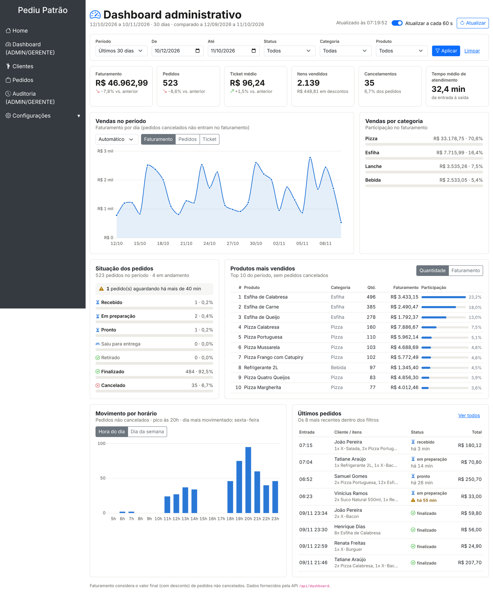
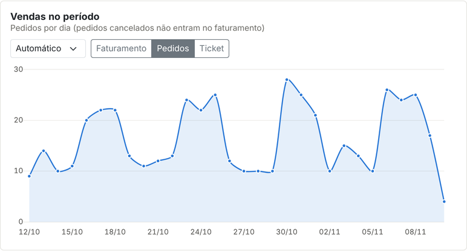
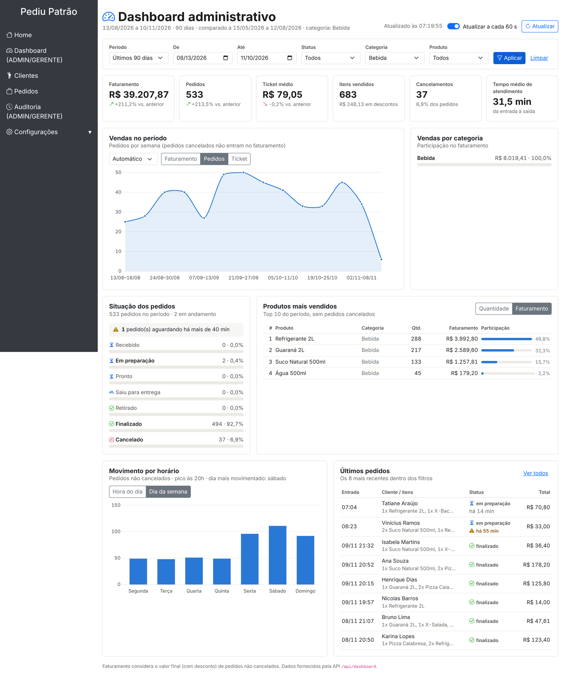
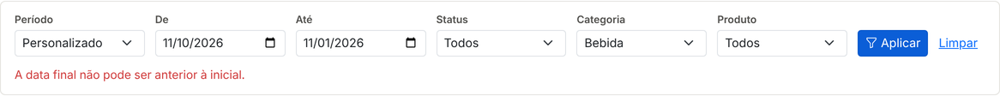
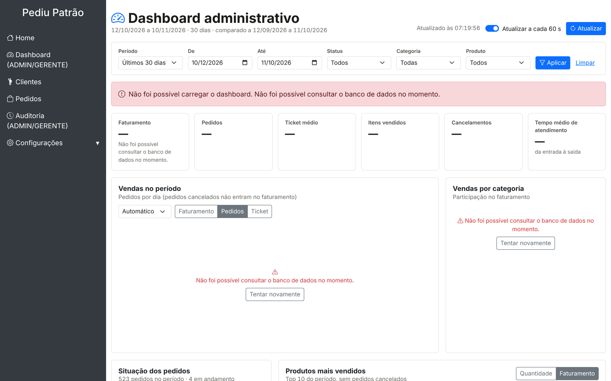
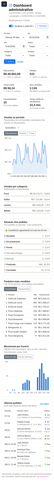

# Dashboard Administrativo — Pediu Patrão

Documento de análise, projeto, API e testes do Dashboard Administrativo integrado ao sistema de pedidos Pediu Patrão (Spring Boot 3.4, Java 21, MongoDB, Thymeleaf).

**Sumário**

1. [Contexto e objetivo](#1-contexto-e-objetivo)
2. [Requisitos funcionais](#2-requisitos-funcionais)
3. [Requisitos não funcionais](#3-requisitos-não-funcionais)
4. [Regras de negócio dos indicadores](#4-regras-de-negócio-dos-indicadores)
5. [Projeto da solução](#5-projeto-da-solução)
6. [Documentação dos endpoints](#6-documentação-dos-endpoints)
7. [Evidências de testes](#7-evidências-de-testes)
8. [Dashboard funcional](#8-dashboard-funcional)
9. [Como executar](#9-como-executar)
10. [Fluxo de versionamento (Gitflow)](#10-fluxo-de-versionamento-gitflow)

---

## 1. Contexto e objetivo

O responsável pelo estabelecimento (perfis **ADMIN** e **GERENTE**) precisa acompanhar o desempenho das vendas, a situação dos pedidos em tempo quase real e as tendências da operação (produtos, categorias, horários de pico) para tomar decisões como reforçar a equipe em horários de pico, revisar o cardápio ou investigar cancelamentos.

A solução tem duas partes:

* uma **API REST somente leitura** (`/api/dashboard/**`) que consulta o MongoDB e calcula os indicadores;
* uma **tela** (`/dashboard`) que consome essa API com JavaScript e apresenta indicadores, gráficos, rankings e filtros.

## 2. Requisitos funcionais

| ID | Requisito | Como foi atendido | Endpoint(s) |
|---|---|---|---|
| **RF01** | Indicadores gerais de vendas | Cartões com faturamento, nº de pedidos, ticket médio, itens vendidos, descontos concedidos, cancelamentos (quantidade e taxa) e tempo médio de atendimento. Faturamento, pedidos e ticket mostram a variação em relação ao período anterior de mesmo tamanho. | `GET /api/dashboard/resumo` |
| **RF02** | Análise de vendas (gráficos) | Gráfico de linha da evolução no tempo (faturamento, pedidos ou ticket médio, agrupado por dia/semana/mês); barras de participação por categoria; gráfico de barras do movimento por hora do dia e por dia da semana com indicação de pico. | `GET /api/dashboard/vendas/serie`, `/vendas/categorias`, `/vendas/horarios` |
| **RF03** | Situação dos pedidos | Quantidade e percentual por status no fluxo (RECEBIDO → … → FINALIZADO, CANCELADO), pedidos em andamento, alerta de pedidos atrasados (parados antes da saída além do limite) e lista dos últimos pedidos com tempo em aberto. | `GET /api/dashboard/pedidos/situacao`, `/pedidos/recentes` |
| **RF04** | Produtos mais vendidos | Ranking (top 10) ordenável por quantidade ou faturamento, com categoria, nº de pedidos e participação percentual. Pedidos cancelados não entram. | `GET /api/dashboard/produtos/ranking` |
| **RF05** | Filtros de consulta | Período (atalhos: hoje, 7/30/90 dias, este mês, mês passado ou datas personalizadas), status, categoria e produto. Os filtros valem para todos os cartões, ficam na URL (link compartilhável) e são validados na tela e na API. | parâmetros comuns a todos os endpoints + `GET /api/dashboard/filtros` |
| **RF06** | Integração com a API | A tela não recebe dados do servidor ao ser renderizada: todo o conteúdo vem das chamadas `fetch` aos endpoints REST, em paralelo, com tratamento de erro por cartão. | todos |
| **RF07** | Atualização e tratamento de dados | Atualização automática a cada 60 s (pausada quando a aba fica oculta) e botão "Atualizar"; horário da última atualização; estados de carregando, vazio e erro com "Tentar novamente"; normalização de status legados, valores nulos e itens sem categoria; pedidos sem data são descartados. | todos |

## 3. Requisitos não funcionais

| ID | Categoria | Requisito | Implementação |
|---|---|---|---|
| RNF01 | Segurança | Somente ADMIN e GERENTE acessam o dashboard e a API. | `SecurityConfig`: `GET /api/dashboard/**` e `/dashboard` com `hasAnyRole("ADMIN","GERENTE")`. |
| RNF02 | Segurança | A API do dashboard é somente leitura. | Qualquer método diferente de GET em `/api/dashboard/**` é negado (`denyAll`). |
| RNF03 | Segurança | Erros não expõem detalhes internos. | Handler devolve apenas a mensagem; a stack trace vai só para o log. |
| RNF04 | Integração | Clientes da API recebem 401/403 em JSON, não um redirecionamento HTML. | `exceptionHandling` com entry point e access denied handler JSON para `/api/**`. |
| RNF05 | Desempenho | Respostas em até 2 s para períodos de até 1 ano no volume típico de uma pizzaria (centenas de pedidos/dia). | Recorte por período feito no MongoDB com índice em `dataHoraEntrada`; limite de 366 dias; agregação em memória só dos pedidos do período. |
| RNF06 | Usabilidade | Interface em português, com números em formato brasileiro (R$, vírgula decimal) e fuso do estabelecimento. | `Intl.NumberFormat('pt-BR')`; fuso configurável `pediupatrao.fuso-horario` (padrão `America/Sao_Paulo`). |
| RNF07 | Usabilidade | Responsiva: utilizável em celular (≥ 360 px) sem rolagem horizontal. | Grid CSS que reorganiza os cartões; testado em 390 px. |
| RNF08 | Acessibilidade | Informação nunca depende só de cor. | Status com ícone + texto; variações com seta + sinal; gráficos com rótulos e tooltips. |
| RNF09 | Confiabilidade | Falha em um bloco não derruba a tela inteira. | Cada cartão é carregado e tratado de forma independente (`Promise.allSettled`). |
| RNF10 | Manutenibilidade | Regras de cálculo testáveis sem banco. | `DashboardCalculator` não depende de Spring nem MongoDB; coberto por testes unitários. |
| RNF11 | Portabilidade | Configuração por variáveis de ambiente, sem credenciais no repositório. | `MONGODB_URI`, `PEDIUPATRAO_ADMIN_PASSWORD`, `PEDIUPATRAO_DEMO_DATA`. |

## 4. Regras de negócio dos indicadores

| Indicador | Definição |
|---|---|
| Faturamento | Soma do `valorTotal` (já com desconto) dos pedidos **não cancelados** com entrada no período. Pedidos em andamento entram, porque já foram vendidos. |
| Pedidos | Total de pedidos com entrada no período (inclui cancelados). |
| Ticket médio | Faturamento ÷ pedidos não cancelados. |
| Taxa de cancelamento | Cancelados ÷ total de pedidos × 100. |
| Itens vendidos | Soma das quantidades dos itens dos pedidos não cancelados. |
| Tempo médio de atendimento | Média de (`dataHoraSaida` − `dataHoraEntrada`) dos pedidos não cancelados que já saíram (entrega ou retirada). |
| Período anterior | Mesmo número de dias, imediatamente antes do início (ex.: 01–09/11 compara com 23–31/10). Variação nula quando o período anterior é zero. |
| Em andamento | Status RECEBIDO, EM PREPARAÇÃO, PRONTO ou SAIU PARA ENTREGA. |
| Atrasado | Status RECEBIDO, EM PREPARAÇÃO ou PRONTO há mais de `limiteAtrasoMin` minutos (padrão 40, configurável). |
| Valor por item / categoria | Preço × quantidade × (valorTotal ÷ valorSubtotal). O desconto do pedido é rateado entre os itens, assim a soma das categorias fecha com o faturamento. |
| Filtro por categoria/produto | Considera os pedidos que **contêm** itens da categoria/produto. Indicadores por item (ranking, categorias, itens vendidos) contam só os itens que atendem ao filtro; indicadores por pedido (faturamento, ticket) usam o valor do pedido. |

**Tratamento de dados (RF07):** status legados são unificados (`EM_PREPARACAO`, `Em Preparo` → `EM PREPARAÇÃO`; `ENTREGUE` → `FINALIZADO`; nulo → `RECEBIDO`); valores nulos viram zero; `valorTotal` ausente é recalculado pelos itens menos o desconto; itens antigos sem categoria recebem a categoria do produto no catálogo (ou "Sem categoria"); pedidos sem `dataHoraEntrada` não entram em análises por período.

## 5. Projeto da solução

### 5.1 Arquitetura

```
Navegador (/dashboard)                       Spring Boot                                MongoDB
┌──────────────────────────┐  fetch JSON   ┌──────────────────────────────────────┐   ┌───────────────┐
│ dashboard.html (Thymeleaf)│ ───────────▶ │ SecurityConfig (ADMIN/GERENTE, 401/403)│   │ pedidos        │
│ dashboard.js  + Chart.js  │ ◀─────────── │ DashboardController  (/api/dashboard)  │   │  idx entrada   │
│ filtros, auto-refresh,    │               │ DashboardService     (filtros, período)│──▶│  idx status    │
│ estados de erro/vazio     │               │ DashboardPedidoRepository (MongoTemplate)  │ produtos       │
└──────────────────────────┘               │ DashboardCalculator  (regras puras)    │   │ clientes       │
                                            │ DashboardExceptionHandler (erros JSON) │   └───────────────┘
                                            └──────────────────────────────────────┘
```

Código novo no pacote `com.umc.pediupatrao.dashboard`:

| Classe | Responsabilidade |
|---|---|
| `DashboardController` | Endpoints REST e vínculo dos parâmetros de filtro. |
| `DashboardService` | Valida filtros, define o período anterior, busca dados e monta o envelope de resposta. |
| `DashboardPedidoRepository` | Consulta pedidos por intervalo de `dataHoraEntrada` com `MongoTemplate`. |
| `DashboardCalculator` | Todas as regras de cálculo (sem dependência de framework). |
| `DashboardFiltro`, `StatusPedido` | Validação de filtros e normalização de status. |
| `DashboardDtos` | Records de resposta (contrato JSON). |
| `DashboardExceptionHandler` | Erros 400/503/500 padronizados. |
| `DashboardPageController` | Rota da página `/dashboard`. |
| `DemoDataGenerator`, `DemoDataSeeder` | Dados fictícios opcionais para demonstração local. |

Alterações em código existente: `SecurityConfig` (regras do dashboard e 401/403 JSON), `MongoInitConfig` (índices), `Pedido.ItemPedido` (campo `categoria`), `PedidoService` (grava a categoria do produto no item), menu lateral.

### 5.2 Modelagem de dados

O dashboard **não cria coleções**: ele lê as coleções `pedidos`, `produtos` e `clientes`, que já existem. Mudanças no modelo:

* `pedidos.itens[].categoria` (novo): categoria do produto (`Produto.tipo`) copiada no momento da venda. Assim o histórico não muda se o produto for recategorizado depois, e a análise por categoria não precisa de junção.
* Índices em `pedidos`: `{dataHoraEntrada: -1}` (recorte por período) e `{status: 1, dataHoraEntrada: -1}`.

Campos usados de `pedidos`: `status`, `dataHoraEntrada`, `dataHoraSaida`, `valorSubtotal`, `valorDesconto`, `valorTotal`, `clienteId`, `responsavelRegistro`, `itens[] {nome, quantidade, precoUnitario, categoria}`.

### 5.3 Principais decisões e justificativas

1. **Vários endpoints pequenos em vez de um endpoint único "/dashboard".** Cada bloco da tela tem um endpoint e um DTO próprios. A tela carrega em paralelo, um bloco com erro não derruba os outros, e trocar só a ordenação do ranking ou o agrupamento do gráfico recarrega só aquele bloco. O contrato fica mais simples de documentar e testar.
2. **Recorte no banco e agregação na aplicação.** O MongoDB filtra pelo período (consulta indexada) e a aplicação agrega. Motivos: os status antigos têm grafias diferentes e precisam ser normalizados antes de agrupar; o rateio de desconto por item e o comparativo ficam mais claros e testáveis em Java; o volume de uma pizzaria (alguns milhares de pedidos por mês) cabe com folga em memória. Se o volume crescer muito, as mesmas regras podem migrar para um *aggregation pipeline* sem mudar o contrato da API.
3. **Regras isoladas em `DashboardCalculator`.** Sem dependência de Spring/MongoDB, as regras são testadas com dados montados à mão e resultados conferidos manualmente.
4. **Envelope padrão `{filtros, geradoEm, dados}`.** O cliente sabe exatamente qual período foi usado (inclusive o padrão de 30 dias) e quando o dado foi gerado (RF07).
5. **Período anterior automático.** Comparar com o período imediatamente anterior, de mesmo tamanho, responde à pergunta "estamos vendendo mais ou menos?" sem exigir outro filtro.
6. **Segurança no servidor.** O acesso é validado no `SecurityConfig` e não depende de esconder botões; a API devolve 401/403 em JSON para facilitar a integração.
7. **Chart.js já incluso no projeto (v2.9.4, em `/plugins`).** Não adiciona dependência externa nem CDN novo. Seguimos boas práticas de visualização: um eixo por gráfico (sem eixo duplo), barras ordenadas em vez de pizza para comparar categorias, uma cor para a série e cores de status sempre acompanhadas de ícone e texto.
8. **Dados de demonstração opcionais e isolados.** Só são gerados com `PEDIUPATRAO_DEMO_DATA=true` e com a coleção de pedidos vazia, marcados com `responsavelRegistro = "demo-seed"`, e não geram registros de auditoria.

## 6. Documentação dos endpoints

**Base:** `/api/dashboard` · **Autenticação:** sessão do login (cookie `JSESSIONID`) · **Perfis:** ADMIN, GERENTE · **Formato:** JSON (UTF-8) · Datas no formato `AAAA-MM-DD`, instantes em ISO-8601 UTC.

### 6.1 Parâmetros de filtro comuns

Aceitos por todos os endpoints, exceto `/filtros`.

| Parâmetro | Tipo | Obrigatório | Padrão | Regras |
|---|---|---|---|---|
| `inicio` | data `AAAA-MM-DD` | não | `fim` − 29 dias | ≤ `fim` |
| `fim` | data `AAAA-MM-DD` | não | hoje (fuso do estabelecimento) | período total ≤ 366 dias |
| `status` | texto, repetível ou separado por vírgula | não | todos | RECEBIDO, EM PREPARAÇÃO, PRONTO, SAIU PARA ENTREGA, RETIRADO, FINALIZADO, CANCELADO (aceita sem acento e com `_`) |
| `categoria` | texto | não | todas | comparação sem diferenciar maiúsculas |
| `produto` | texto | não | todos | nome exato do produto, sem diferenciar maiúsculas |

### 6.2 Envelope de resposta

```json
{
  "filtros": { "inicio": "2026-11-01", "fim": "2026-11-09", "dias": 9, "status": [], "categoria": null, "produto": null, "fusoHorario": "America/Sao_Paulo" },
  "geradoEm": "2026-11-10T10:20:13.825Z",
  "dados": { }
}
```

### 6.3 Formato de erro

```json
{ "erro": "Parâmetro 'inicio' inválido: '10/11/2026'. Use o formato AAAA-MM-DD (ex.: 2026-11-10).",
  "status": 400, "caminho": "/api/dashboard/resumo", "timestamp": "2026-11-10T10:21:00Z" }
```

| HTTP | Quando ocorre | Exemplo de mensagem |
|---|---|---|
| 400 | Data mal formatada | `Parâmetro 'inicio' inválido: '10/11/2026'. Use o formato AAAA-MM-DD (ex.: 2026-11-10).` |
| 400 | `fim` antes de `inicio` | `Período inválido: a data final (2026-11-01) é anterior à data inicial (2026-11-10).` |
| 400 | Período > 366 dias | `Período muito longo (1045 dias). O máximo permitido é 366 dias.` |
| 400 | Status desconhecido | `Status inválido: 'PERDIDO'. Valores aceitos: RECEBIDO, EM PREPARAÇÃO, ...` |
| 400 | `agrupamento`, `ordenarPor`, `limite` ou `limiteAtrasoMin` inválidos | `Parâmetro 'limite' deve estar entre 1 e 50.` |
| 401 | Requisição sem sessão autenticada | `Não autenticado. Faça login para acessar a API.` |
| 403 | Perfil sem permissão (ATENDENTE) ou método diferente de GET | `Acesso negado para o seu perfil.` |
| 503 | MongoDB indisponível | `Não foi possível consultar o banco de dados no momento. Tente novamente em instantes.` |
| 500 | Erro inesperado (detalhe só no log) | `Erro interno ao gerar os dados do dashboard.` |

> Os exemplos de resposta abaixo foram obtidos com os dados de demonstração (fictícios) e encurtados onde indicado.

### 6.4 `GET /api/dashboard/resumo` — indicadores gerais (RF01)

Parâmetros: apenas os comuns.

```
GET /api/dashboard/resumo?inicio=2026-11-01&fim=2026-11-09
```

```json
{
  "filtros": { "inicio": "2026-11-01", "fim": "2026-11-09", "dias": 9, "status": [], "categoria": null, "produto": null, "fusoHorario": "America/Sao_Paulo" },
  "geradoEm": "2026-11-10T10:20:13.825Z",
  "dados": {
    "faturamento": 15525.98,
    "totalPedidos": 177,
    "pedidosValidos": 161,
    "pedidosCancelados": 16,
    "ticketMedio": 96.43,
    "itensVendidos": 630,
    "descontoConcedido": 144.22,
    "taxaCancelamentoPercentual": 9.0,
    "pedidosEmAndamento": 0,
    "tempoMedioAtendimentoMinutos": 32.3,
    "comparativo": {
      "inicioAnterior": "2026-10-23", "fimAnterior": "2026-10-31",
      "faturamentoAnterior": 15591.59, "variacaoFaturamentoPercentual": -0.4,
      "pedidosAnterior": 172, "variacaoPedidosPercentual": 2.9,
      "ticketMedioAnterior": 93.93, "variacaoTicketMedioPercentual": 2.7
    }
  }
}
```

`tempoMedioAtendimentoMinutos` e as variações podem ser `null` (sem dados suficientes).

### 6.5 `GET /api/dashboard/vendas/serie` — evolução das vendas (RF02)

| Parâmetro extra | Valores | Padrão |
|---|---|---|
| `agrupamento` | `DIA`, `SEMANA` (segunda a domingo), `MES` | automático: até 31 dias → DIA; até 180 → SEMANA; acima → MES |

Todos os intervalos do período são devolvidos, inclusive os sem venda (com zero). O primeiro e o último podem ser parciais (`inicio`/`fim` recortados ao período).

```
GET /api/dashboard/vendas/serie?inicio=2026-10-27&fim=2026-11-09&agrupamento=SEMANA
```

```json
{
  "filtros": { "inicio": "2026-10-27", "fim": "2026-11-09", "dias": 14, "...": "..." },
  "geradoEm": "2026-11-10T10:20:13.870Z",
  "dados": {
    "agrupamento": "SEMANA",
    "pontos": [
      { "rotulo": "27/10–01/11", "inicio": "2026-10-27", "fim": "2026-11-01", "faturamento": 9949.55, "pedidos": 104, "cancelados": 9, "ticketMedio": 95.67 },
      { "rotulo": "02/11–08/11", "inicio": "2026-11-02", "fim": "2026-11-08", "faturamento": 11801.26, "pedidos": 123, "cancelados": 10, "ticketMedio": 95.95 },
      { "rotulo": "09/11–09/11", "inicio": "2026-11-09", "fim": "2026-11-09", "faturamento": 1712.96, "pedidos": 17, "cancelados": 0, "ticketMedio": 100.76 }
    ]
  }
}
```

`pedidos` conta os não cancelados do intervalo; `cancelados` aparece à parte.

### 6.6 `GET /api/dashboard/vendas/categorias` — vendas por categoria (RF02)

```
GET /api/dashboard/vendas/categorias?inicio=2026-11-01&fim=2026-11-09
```

```json
{
  "filtros": { "...": "..." },
  "geradoEm": "2026-11-10T10:20:13.900Z",
  "dados": [
    { "categoria": "Pizza",  "quantidade": 222, "faturamento": 11543.26, "percentualFaturamento": 74.3 },
    { "categoria": "Esfiha", "quantidade": 301, "faturamento": 2011.85,  "percentualFaturamento": 13.0 },
    { "categoria": "Lanche", "quantidade": 46,  "faturamento": 1219.49,  "percentualFaturamento": 7.9 },
    { "categoria": "Bebida", "quantidade": 61,  "faturamento": 751.40,   "percentualFaturamento": 4.8 }
  ]
}
```

Ordenado por faturamento (decrescente).

### 6.7 `GET /api/dashboard/vendas/horarios` — tendências por horário (RF02)

```
GET /api/dashboard/vendas/horarios?inicio=2026-11-01&fim=2026-11-09
```

```json
{
  "filtros": { "...": "..." },
  "geradoEm": "2026-11-10T10:20:14.010Z",
  "dados": {
    "porHora": [ { "hora": 0, "pedidos": 0, "faturamento": 0.00 }, "... 24 faixas ...", { "hora": 20, "pedidos": 34, "faturamento": 3629.37 } ],
    "porDiaSemana": [ { "dia": 1, "nome": "segunda-feira", "pedidos": 27, "faturamento": 2666.21 }, "... 7 dias ...", { "dia": 7, "nome": "domingo", "pedidos": 46, "faturamento": 4452.76 } ],
    "horaPico": 20,
    "diaSemanaPico": "domingo"
  }
}
```

`dia` segue a ISO-8601 (1 = segunda … 7 = domingo). `horaPico`/`diaSemanaPico` são `null` quando não há pedidos.

### 6.8 `GET /api/dashboard/pedidos/situacao` — situação dos pedidos (RF03)

| Parâmetro extra | Tipo | Padrão | Regras |
|---|---|---|---|
| `limiteAtrasoMin` | inteiro | 40 (`pediupatrao.dashboard.limite-atraso-minutos`) | 5 a 240 |

```
GET /api/dashboard/pedidos/situacao?inicio=2026-11-10&fim=2026-11-10
```

```json
{
  "filtros": { "inicio": "2026-11-10", "fim": "2026-11-10", "dias": 1, "...": "..." },
  "geradoEm": "2026-11-10T10:20:13.928Z",
  "dados": {
    "porStatus": [
      { "status": "RECEBIDO",          "quantidade": 1, "percentual": 25.0, "valor": 180.12 },
      { "status": "EM PREPARAÇÃO",     "quantidade": 2, "percentual": 50.0, "valor": 103.80 },
      { "status": "PRONTO",            "quantidade": 1, "percentual": 25.0, "valor": 250.70 },
      { "status": "SAIU PARA ENTREGA", "quantidade": 0, "percentual": 0.0,  "valor": 0.00 },
      { "status": "RETIRADO",          "quantidade": 0, "percentual": 0.0,  "valor": 0.00 },
      { "status": "FINALIZADO",        "quantidade": 0, "percentual": 0.0,  "valor": 0.00 },
      { "status": "CANCELADO",         "quantidade": 0, "percentual": 0.0,  "valor": 0.00 }
    ],
    "total": 4,
    "emAndamento": 4,
    "atrasados": 1,
    "limiteAtrasoMinutos": 40,
    "tempoMedioAtendimentoMinutos": null
  }
}
```

Os status aparecem sempre na ordem do fluxo, inclusive com zero.

### 6.9 `GET /api/dashboard/pedidos/recentes` — últimos pedidos (RF03)

| Parâmetro extra | Tipo | Padrão | Regras |
|---|---|---|---|
| `limite` | inteiro | 10 | 1 a 50 |
| `limiteAtrasoMin` | inteiro | 40 | 5 a 240 |

```
GET /api/dashboard/pedidos/recentes?inicio=2026-11-10&fim=2026-11-10&limite=2
```

```json
{
  "filtros": { "...": "..." },
  "geradoEm": "2026-11-10T10:20:13.961Z",
  "dados": [
    { "id": "67400000000000000000080f", "cliente": "João Pereira", "status": "RECEBIDO", "valorTotal": 180.12,
      "itens": "1x X-Salada, 2x Pizza Portuguesa, 1x Pizza Margherita", "quantidadeItens": 4,
      "dataHoraEntrada": "2026-11-10T10:15:56Z", "dataHoraSaida": null,
      "minutosEmAberto": 4, "atrasado": false, "responsavel": "demo-seed" },
    { "id": "674000000000000000000810", "cliente": "Tatiane Araújo", "status": "EM PREPARAÇÃO", "valorTotal": 70.80,
      "itens": "1x Refrigerante 2L, 1x X-Bacon, 1x X-Salada", "quantidadeItens": 3,
      "dataHoraEntrada": "2026-11-10T10:04:56Z", "dataHoraSaida": null,
      "minutosEmAberto": 15, "atrasado": false, "responsavel": "demo-seed" }
  ]
}
```

`minutosEmAberto` só é preenchido para pedidos em andamento. Sem `clienteId`, `cliente` = "Não informado".

### 6.10 `GET /api/dashboard/produtos/ranking` — produtos mais vendidos (RF04)

| Parâmetro extra | Valores | Padrão |
|---|---|---|
| `limite` | 1 a 50 | 10 |
| `ordenarPor` | `QUANTIDADE`, `FATURAMENTO` | `QUANTIDADE` |

```
GET /api/dashboard/produtos/ranking?inicio=2026-11-01&fim=2026-11-09&limite=3&ordenarPor=FATURAMENTO
```

```json
{
  "filtros": { "...": "..." },
  "geradoEm": "2026-11-10T10:20:13.994Z",
  "dados": [
    { "posicao": 1, "produto": "Pizza Calabresa",  "categoria": "Pizza", "quantidade": 53, "faturamento": 2609.76, "pedidos": 44, "participacaoPercentual": 16.8 },
    { "posicao": 2, "produto": "Pizza Portuguesa", "categoria": "Pizza", "quantidade": 45, "faturamento": 2440.31, "pedidos": 31, "participacaoPercentual": 15.7 },
    { "posicao": 3, "produto": "Pizza Mussarela",  "categoria": "Pizza", "quantidade": 40, "faturamento": 1813.05, "pedidos": 32, "participacaoPercentual": 11.7 }
  ]
}
```

`participacaoPercentual` é relativa ao critério de ordenação (quantidade ou faturamento). Empates são resolvidos pelo outro critério e depois pelo nome.

### 6.11 `GET /api/dashboard/filtros` — opções de filtro (RF05)

Sem parâmetros. Não usa o envelope.

```json
{
  "status": ["RECEBIDO", "EM PREPARAÇÃO", "PRONTO", "SAIU PARA ENTREGA", "RETIRADO", "FINALIZADO", "CANCELADO"],
  "categorias": ["Bebida", "Esfiha", "Lanche", "Pizza"],
  "produtos": ["Água 500ml", "Esfiha de Calabresa", "...", "X-Salada"],
  "agrupamentos": ["DIA", "SEMANA", "MES"],
  "ordenacoesRanking": ["QUANTIDADE", "FATURAMENTO"],
  "inicioPadrao": "2026-10-12",
  "fimPadrao": "2026-11-10",
  "primeiroPedido": "2026-07-14T14:30:25Z",
  "ultimoPedido": "2026-11-10T09:23:56Z",
  "maximoDias": 366,
  "fusoHorario": "America/Sao_Paulo"
}
```

`primeiroPedido`/`ultimoPedido` são `null` quando ainda não há pedidos.

### 6.12 Exemplos com cURL

```bash
# 1) login (guarda o cookie de sessão)
curl -c cookies.txt -s http://localhost:8080/login -o login.html
CSRF=$(grep -o 'name="_csrf"[^>]*value="[^"]*"' login.html | sed 's/.*value="\([^"]*\)"/\1/')
curl -b cookies.txt -c cookies.txt -s -o /dev/null -X POST http://localhost:8080/login \
  --data-urlencode username=gerente --data-urlencode password=demo123 --data-urlencode _csrf=$CSRF

# 2) consultas
curl -b cookies.txt "http://localhost:8080/api/dashboard/resumo?inicio=2026-11-01&fim=2026-11-09"
curl -b cookies.txt "http://localhost:8080/api/dashboard/produtos/ranking?ordenarPor=FATURAMENTO&limite=5"
curl -b cookies.txt "http://localhost:8080/api/dashboard/pedidos/situacao?status=RECEBIDO,EM%20PREPARA%C3%87%C3%83O"
```

O script `docs/testes/testar-api.sh` automatiza o login e executa todos os casos de teste da seção 7.3.

## 7. Evidências de testes

### 7.1 Estratégia

| Nível | O que cobre | Arquivo |
|---|---|---|
| Unitário (regras) | Cálculos de RF01–RF04, filtros, normalização, casos de borda | `DashboardCalculatorTest`, `DashboardFiltroTest`, `StatusPedidoTest`, `DemoDataGeneratorTest` |
| Camada web (MockMvc) | Rotas, perfis (401/403), validação (400), banco indisponível (503), JSON de resposta | `DashboardControllerTest` |
| Integração (app + MongoDB) | Endpoints reais com login, banco e índices | `docs/testes/testar-api.sh` |
| Interface | Carga, filtros, alternância de gráficos, validação, erros 403/503, celular | navegador (seção 8) |

Executar: `./mvnw test` (ou `mvnw.cmd test` no Windows).

### 7.2 Testes unitários — cenário conferido manualmente

Cenário de `DashboardCalculatorTest` (fuso de São Paulo, período 01–10/11/2026, "agora" = 10/11 19:00):

| Pedido | Status | Entrada | Itens | Total |
|---|---|---|---|---|
| p1 | FINALIZADO (saiu em 40 min) | 02/11 20:00 | 2× Pizza Calabresa R$ 50 + 1× Refrigerante R$ 10, desconto 10% | R$ 99,00 |
| p2 | FINALIZADO (saiu em 30 min) | 02/11 12:30 | 2× X-Burguer R$ 25 | R$ 50,00 |
| p3 | CANCELADO | 05/11 21:00 | 1× Pizza Calabresa | R$ 50,00 |
| p4 | `EM_PREPARACAO` (grafia legada), item sem categoria | 10/11 18:00 | 1× Pizza Mussarela R$ 40 | R$ 40,00 |
| p5 | RECEBIDO | 10/11 18:50 | 2× Refrigerante R$ 10 | R$ 20,00 |
| p6 | sem data de entrada | — | — | R$ 999,00 (deve ser ignorado) |

Valores esperados, calculados à mão: faturamento = 99 + 50 + 40 + 20 = **R$ 209,00**; ticket = 209 ÷ 4 = **R$ 52,25**; cancelamento = 1 ÷ 5 = **20%**; tempo médio = (40 + 30) ÷ 2 = **35 min**; p4 atrasado (60 min > 40); Pizza = 90 + 40 = **R$ 130,00** (desconto rateado: 100 × 99/110 = 90). Período anterior (23–31/10) com R$ 150,00 → variação de faturamento **+39,3%**.

Resultado da execução (os 28 testes de regra de negócio):

```
PASS DashboardCalculatorTest.agrupamentoAutomaticoDependeDoTamanhoDoPeriodo
PASS DashboardCalculatorTest.categoriasRateiamDescontoEFechamComFaturamento
PASS DashboardCalculatorTest.filtroPorCategoriaRestringePedidosEItens
PASS DashboardCalculatorTest.filtroPorProdutoIgnoraMaiusculas
PASS DashboardCalculatorTest.filtroPorStatus
PASS DashboardCalculatorTest.horariosIdentificamPicos
PASS DashboardCalculatorTest.pedidoLegadoSemValorTotalUsaItensMenosDesconto
PASS DashboardCalculatorTest.periodoSemPedidosRetornaZerosSemErro
PASS DashboardCalculatorTest.rankingPorFaturamentoELimite
PASS DashboardCalculatorTest.rankingPorQuantidadeIgnoraCancelados
PASS DashboardCalculatorTest.recentesOrdenaPorEntradaEMarcaAtraso
PASS DashboardCalculatorTest.resumoCalculaIndicadoresGerais
PASS DashboardCalculatorTest.resumoComparaComPeriodoAnteriorDeMesmoTamanho
PASS DashboardCalculatorTest.serieDiariaPreencheDiasSemVendaComZero
PASS DashboardCalculatorTest.serieSemanalRecortaSemanasParciais
PASS DashboardCalculatorTest.situacaoContaPorStatusNormalizadoEAtrasados
PASS DashboardCalculatorTest.variacaoEhNulaQuandoNaoHaBaseDeComparacao
PASS DashboardFiltroTest.apenasFimInformadoCalculaInicio
PASS DashboardFiltroTest.dataEmFormatoInvalidoGeraMensagemClara
PASS DashboardFiltroTest.fimAnteriorAoInicioEhRecusado
PASS DashboardFiltroTest.periodoAnteriorTemMesmoTamanho
PASS DashboardFiltroTest.periodoMaiorQueUmAnoEhRecusado
PASS DashboardFiltroTest.semParametrosUsaUltimosTrintaDias
PASS DashboardFiltroTest.statusAceitaVariacoesEListaSeparadaPorVirgula
PASS DashboardFiltroTest.statusDesconhecidoEhRecusado
PASS StatusPedidoTest.filtroNaoAceitaStatusDesconhecido
PASS StatusPedidoTest.normalizaVariacoesLegadas
PASS DemoDataGeneratorTest.pedidosGeradosSaoConsistentes
Tests: 28, passed: 28, failed: 0
```

Execução realizada em 10/11/2026 com `mvnw.cmd test`:

```
[INFO] Tests run: 17, Failures: 0, Errors: 0, Skipped: 0 -- in com.umc.pediupatrao.dashboard.DashboardCalculatorTest
[INFO] Tests run: 10, Failures: 0, Errors: 0, Skipped: 0 -- in com.umc.pediupatrao.dashboard.DashboardControllerTest
[INFO] Tests run: 8, Failures: 0, Errors: 0, Skipped: 0 -- in com.umc.pediupatrao.dashboard.DashboardFiltroTest
[INFO] Tests run: 1, Failures: 0, Errors: 0, Skipped: 0 -- in com.umc.pediupatrao.dashboard.DemoDataGeneratorTest
[INFO] Tests run: 2, Failures: 0, Errors: 0, Skipped: 0 -- in com.umc.pediupatrao.dashboard.StatusPedidoTest
[INFO] Tests run: 3, Failures: 0, Errors: 0, Skipped: 0 -- in com.umc.pediupatrao.service.PedidoServiceTest
[INFO] Tests run: 41, Failures: 0, Errors: 0, Skipped: 0
[INFO] BUILD SUCCESS
```

### 7.3 Testes da API (camada web e integração)

Casos cobertos por `DashboardControllerTest` (MockMvc) e repetidos contra a aplicação real por `docs/testes/testar-api.sh`:

| # | Caso | Requisição | Esperado |
|---|---|---|---|
| 1 | Sem login | `GET /resumo` | 401 JSON |
| 2 | Perfil ATENDENTE | `GET /resumo` | 403 JSON |
| 3 | GERENTE, filtros padrão | `GET /resumo` | 200, `filtros.dias = 30` |
| 4 | ADMIN, ranking por faturamento | `GET /produtos/ranking?limite=5&ordenarPor=faturamento` | 200, `posicao = 1` |
| 5 | Opções de filtro | `GET /filtros` | 200, lista de status |
| 6 | Série semanal, categorias, horários, situação, recentes | `GET /vendas/serie?agrupamento=SEMANA` etc. | 200 |
| 7 | Data inválida | `?inicio=10/11/2026` | 400, mensagem cita AAAA-MM-DD |
| 8 | Período invertido | `?inicio=2026-11-10&fim=2026-11-01` | 400 |
| 9 | Período > 366 dias | `?inicio=2024-01-01&fim=2026-11-10` | 400 |
| 10 | `limite=abc`, `limite=0`/`100`, `ordenarPor=preco`, `agrupamento=ANO`, `status=PERDIDO` | — | 400 |
| 11 | Escrita na API | `POST /resumo` | 403 |
| 12 | MongoDB fora do ar | (repositório lança `DataAccessException`) | 503 |

> **Para a entrega:** com a aplicação rodando (`PEDIUPATRAO_DEMO_DATA=true`), execute `./docs/testes/testar-api.sh`. O resultado é salvo em `docs/testes/resultado-api.txt`; faça commit desse arquivo como evidência.

### 7.4 Testes de interface

Executados no navegador (Chromium) em 1440 px e 390 px, com os mesmos cálculos da API sobre os dados de demonstração:

| Caso | Resultado |
|---|---|
| Carga inicial chama os 8 endpoints e preenche todos os cartões | OK — sem erros no console |
| Alternar Faturamento/Pedidos/Ticket e Hora/Dia da semana | OK — redesenha sem nova chamada |
| Ordenar ranking por faturamento | OK — recarrega só `/produtos/ranking` |
| Filtro "Últimos 90 dias" + categoria Bebida | OK — URL `?periodo=90&categoria=Bebida`, agrupamento semanal automático, ranking só com bebidas |
| Data final anterior à inicial | OK — mensagem na tela e nenhuma chamada à API |
| API retornando 503 | OK — aviso geral e "Tentar novamente" em cada cartão |
| API retornando 403 | OK — mensagem de perfil sem permissão e atualização automática pausada |
| Celular (390 px) | OK — sem rolagem horizontal |

Capturas em `docs/evidencias/` (seção 8).

## 8. Dashboard funcional

Visão geral (últimos 30 dias, dados de demonstração):



Gráfico de vendas com tooltip (métrica "Pedidos"):



Filtro de 90 dias + categoria Bebida (agrupamento semanal automático):



Validação de período no formulário:



Tratamento de erro com o banco indisponível (503):



Versão para celular:



## 9. Como executar

```bash
# MongoDB local em mongodb://localhost:27017/pizzaria (ou defina MONGODB_URI)
export PEDIUPATRAO_DEMO_DATA=true          # opcional: popula dados fictícios se não houver pedidos
export PEDIUPATRAO_ADMIN_PASSWORD=trocar123
./mvnw spring-boot:run                       # Windows: mvnw.cmd spring-boot:run
# abrir http://localhost:8080/login  →  menu "Dashboard"
```

Com `PEDIUPATRAO_DEMO_DATA=true` são criados (somente se não existirem) os usuários `gerente` e `atendente` com senha `demo123` (ou `PEDIUPATRAO_DEMO_PASSWORD`), 16 produtos, 20 clientes e cerca de 2 mil pedidos fictícios dos últimos 120 dias. Nunca use essa opção em produção.

Configurações em `application.properties`:

| Propriedade | Padrão | Uso |
|---|---|---|
| `pediupatrao.fuso-horario` | `America/Sao_Paulo` | Define "dia" e "hora" nos indicadores |
| `pediupatrao.dashboard.limite-atraso-minutos` | `40` | Pedido parado antes da saída por mais tempo que isso é "atrasado" |
| `pediupatrao.demo-data` | `${PEDIUPATRAO_DEMO_DATA:false}` | Liga os dados de demonstração |

## 10. Fluxo de versionamento (Gitflow)

```
main      ●──────────────────────────────────────────────●  v1.1.0
           \                                            /
develop     ●────────●──────────●──────────●───────────●
                    /          /          /
feature/dashboard-api   feature/dashboard-ui   feature/dashboard-docs
                                            \
                                   release/1.1.0 → main (tag v1.1.0) e de volta para develop
```

* `main`: versão entregue (tag `v1.1.0`).
* `develop`: integração.
* `feature/dashboard-api`: endpoints, regras, segurança, índices e testes da API.
* `feature/dashboard-ui`: tela do dashboard.
* `feature/dashboard-docs`: esta documentação, script de testes e roteiro do vídeo.
* `release/1.1.0`: fechamento da versão.

Commits seguem o padrão *Conventional Commits* (`feat:`, `docs:`, `chore:`).
